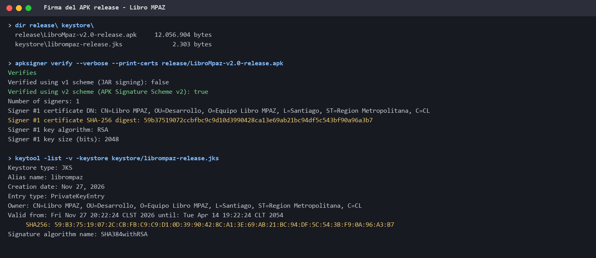

# Libro MPAZ — Libro digital de clases

Aplicación Android para la Escuela Escritora Marcela Paz (San Bernardo). Reemplaza el libro de clases en papel (asistencia, cobertura curricular, calificaciones y hoja de vida) por una app con vistas por perfil: **Docente, UTP, Inspectoría y Dirección**.

Kotlin · Jetpack Compose · Material 3 · MVVM · Room · Retrofit · Microservicios Spring Boot.

| Repositorio | Contenido |
|---|---|
| **App móvil (este repositorio):** https://github.com/nicolasCo26/LibroMpaz | App Android, pruebas, APK firmado y llave |
| **Microservicios:** https://github.com/nicolasCo26/LibroMpaz-Microservicios | `ms-calificaciones` y `ms-anotaciones` (Spring Boot + H2) |

## Integrantes

| Nombre | Usuario GitHub | Qué desarrolló |
|---|---|---|
| Nicolás Navarrete Reyes | [nicolasCo26](https://github.com/nicolasCo26) | Persistencia con Room, ViewModel y reglas, asistencia, calificaciones, recurso nativo, microservicios e integración con Retrofit, pruebas y firma del APK |
| Camila Leiva | [alemi-vy](https://github.com/alemi-vy) | Login y navegación por rol, pantallas del docente (clase y hoja de vida), paneles de UTP e Inspectoría, README |

**Planificación y control de versiones:** cada funcionalidad se desarrolló en su propia rama (`feat/...`, `test/...`, `release/...`) y se integró a `main` con un Pull Request: [PR de la app](https://github.com/nicolasCo26/LibroMpaz/pulls?q=is%3Apr) y [PR de los microservicios](https://github.com/nicolasCo26/LibroMpaz-Microservicios/pulls?q=is%3Apr).

## Funcionalidades

| Perfil | Qué puede hacer |
|---|---|
| Docente | Ver solo sus cursos y asignaturas · pasar asistencia (P/A/T/J) · registrar la clase con OA y contenidos · **crear, editar y eliminar evaluaciones e ingresar notas (microservicio)** · **registrar, corregir y eliminar anotaciones de la hoja de vida (microservicio)** · ver los próximos feriados (API externa) |
| UTP | Cobertura curricular por curso y asignatura · revisión de evaluaciones sin notas o incompletas |
| Inspectoría | Asistencia de todos los cursos · alertas por inasistencias reiteradas y anotaciones negativas · próximos feriados |
| Dirección | Métricas por curso · auditoría de cambios · exportar reporte CSV (recurso nativo) |

Además: validación de formularios con el error bajo cada campo, confirmación antes de sobrescribir o borrar, auditoría automática de cada cambio, aviso si la fecha de asistencia es feriado y aviso de "sin conexión" con botón **Reintentar** cuando los microservicios no responden.

## Endpoints utilizados

### Microservicios propios (Spring Boot, ver repositorio de microservicios)

| Microservicio | Método y ruta | Uso en la app |
|---|---|---|
| ms-calificaciones `:8081` | `GET /api/evaluaciones` | Sincronizar evaluaciones al abrir Calificaciones, Revisión UTP y Panel Dirección |
| | `POST /api/evaluaciones` | Botón **Crear** (nueva evaluación) |
| | `PUT /api/evaluaciones/{id}` | Ícono de lápiz: corregir nombre o fecha |
| | `DELETE /api/evaluaciones/{id}` | Ícono de basurero: eliminar la evaluación y sus notas |
| | `GET /api/calificaciones` | Sincronizar todas las notas |
| | `PUT /api/evaluaciones/{id}/calificaciones` | **Guardar notas** (reemplaza la planilla completa) |
| ms-anotaciones `:8082` | `GET /api/anotaciones` | Sincronizar la hoja de vida (Docente, Alertas de Inspectoría, Dirección) |
| | `POST /api/anotaciones` | **Registrar anotación** (el servidor pone fecha y hora de la firma) |
| | `PUT /api/anotaciones/{id}` | Corregir tipo o descripción (solo quien la firmó, si no responde 403) |
| | `DELETE /api/anotaciones/{id}?solicitante=...` | Eliminar (solo quien la firmó) |

### API externa

| API | Endpoint | Uso en la app |
|---|---|---|
| [Nager.Date](https://date.nager.at) (pública, sin clave) | `GET https://date.nager.at/api/v3/PublicHolidays/{año}/CL` | Tarjeta "Próximos feriados" en Mis cursos y Panel Inspectoría, y aviso en Asistencia si el día es feriado. Solo se lee: no se guarda en Room ni en los microservicios. |

**Diferencia:** los microservicios son nuestros, guardan los datos del colegio y la app hace CRUD sobre ellos (`LibroMpazRepository`). La API externa es de terceros y de solo lectura: tiene su propio repositorio (`FeriadosRepository`) y su propio ViewModel (`FeriadosViewModel`), así que si falla no afecta a los datos del colegio.

## Pasos para ejecutar

### 1. Levantar los microservicios (computador)

Requiere JDK 21. En el repositorio de microservicios, en dos terminales:

```bash
cd ms-calificaciones && ./mvnw spring-boot:run     # Windows: mvnw.cmd spring-boot:run  -> puerto 8081
cd ms-anotaciones    && ./mvnw spring-boot:run     # -> puerto 8082
```

Comprobar: abrir http://localhost:8081/api/evaluaciones y http://localhost:8082/api/anotaciones. La base H2 se ve en http://localhost:8081/h2-console (JDBC URL `jdbc:h2:file:./data/calificaciones`, usuario `sa`, sin clave).

### 2. Ejecutar la app (Android Studio)

1. **File > Open…** → la carpeta que contiene `settings.gradle.kts`. Esperar el Gradle Sync (necesita internet).
2. Gradle JDK 17 o 21 (*Settings > Build Tools > Gradle > Gradle JDK*), no JDK 25. Si sugiere actualizar Gradle o AGP, **no aceptar**.
3. ▶ **Run 'app'** en un emulador (API 24 o superior).

El emulador llega al computador por `10.0.2.2` (configurado en `app/build.gradle.kts`). En un teléfono físico, cambiar esa IP por la del computador en la misma red Wi-Fi y agregarla en `res/xml/network_security_config.xml`.

Si los microservicios están apagados la app no se cae: muestra la última copia guardada y el aviso "Sin conexión con el servidor" con **Reintentar**.

### Usuarios de prueba (ficticios)

| Perfil | Correo | Clave |
|---|---|---|
| Docente (Matemática 3°A y 4°A) | docente.mat@libromp.cl | docente123 |
| Docente (Lenguaje 4°A y Ciencias 3°A) | docente.len@libromp.cl | docente123 |
| UTP | utp@libromp.cl | utp123 |
| Inspectoría | inspectoria@libromp.cl | inspectoria123 |
| Dirección | direccion@libromp.cl | direccion123 |

## Pruebas

### Unitarias (JVM, Kotest + MockK + coroutines-test) — `app/src/test`

```bash
./gradlew testDebugUnitTest           # Windows: gradlew.bat testDebugUnitTest
./gradlew koverHtmlReportDebug        # cobertura -> app/build/reports/kover/htmlDebug/index.html
./gradlew koverVerifyDebug            # falla si la cobertura de la lógica baja de 80 %
```

| Clase de prueba | Qué prueba | Qué se simula (mock) |
|---|---|---|
| `LibroMpazRepositoryTest` | POST/PUT/DELETE a los microservicios y que la copia local solo cambie si el servidor responde bien; sincronización; auditoría | DAO de Room y APIs Retrofit |
| `LibroMpazViewModelTest` | Login, permisos por rol, validaciones, mensajes de error de red (sin conexión, 403, 404), métricas | `LibroMpazRepository` |
| `FeriadosViewModelTest` | Estados Cargando / Éxito / Error de la API externa y próximos feriados | `FeriadosApi` y `FeriadosRepository` |
| `ErroresRedTest`, `ValidacionesTest`, `MetricasTest` | Reglas puras (sin mocks) | — |

Resultado: **65 pruebas, 0 fallos**. Cobertura de la lógica (`viewmodel` + `data.repository`): **97 % de líneas**.

### De interfaz (instrumentadas, se ven en el emulador) — `app/src/androidTest`

Con el emulador abierto: clic derecho en `app/src/androidTest/java/com/librompaz/app` → **Run 'Tests in…'**, o:

```bash
./gradlew connectedDebugAndroidTest
```

- `FlujoAppTest`: login vacío, clave incorrecta, docente que pasa asistencia y vuelve, Inspectoría con feriados.
- `TarjetaFeriadosTest`: la tarjeta de feriados con una API falsa (éxito, error y Reintentar).
- `CalificacionesMicroservicioTest`: crea y elimina una evaluación desde la pantalla contra `ms-calificaciones` (**requiere los microservicios encendidos**).

## APK firmado

- APK: [`release/LibroMpaz-v2.0-release.apk`](release/LibroMpaz-v2.0-release.apk)
- Llave: [`keystore/librompaz-release.jks`](keystore/librompaz-release.jks) (alias `librompaz`, RSA 2048, 10.000 días)
- Configuración: `signingConfigs.release` en `app/build.gradle.kts`, que lee `keystore.properties`.



El SHA-256 del certificado del APK es el mismo de la llave: el APK quedó firmado con ese `.jks`.

**Cómo se generó:**
1. Llave: Android Studio → **Build > Generate Signed App Bundle / APK > APK > Create new…** (o `keytool -genkeypair -keystore keystore/librompaz-release.jks -alias librompaz -keyalg RSA -keysize 2048 -validity 10000`).
2. Variante **release**, firma V2. Por consola: `./gradlew assembleRelease` usa `keystore.properties`.
3. Verificación: `apksigner verify --print-certs app/build/outputs/apk/release/app-release.apk`.

> La llave y sus claves se incluyen en el repositorio solo porque la entrega lo exige. En una app real, `keystore.properties` y el `.jks` quedan fuera de Git.

## Arquitectura (MVVM)

```
Pantalla (@Composable) ──evento──> ViewModel ──> Repository ──┬──> Retrofit ──> Microservicios (Spring Boot + H2)
        ^                            │ valida                 └──> DAO ──> Room (copia local)
        └──── collectAsState() <── StateFlow <──────── Flow de Room ──┘
```

Toda escritura de evaluaciones, notas o anotaciones va **primero al microservicio**; solo si responde bien se actualiza la copia en Room y se registra la auditoría (en la misma transacción). Las pantallas observan Room, así que se redibujan solas.

| Paquete | Responsabilidad |
|---|---|
| `model/` | Entidades de Room (12 tablas) y enums. Evaluación, Calificación y Anotación se reutilizan como JSON de los microservicios. |
| `data/local/` | DAO, `AppDatabase` (singleton) y `Converters`. |
| `data/remote/` | `RetrofitClient` (una instancia por URL base), `CalificacionesApi`, `AnotacionesApi`, `FeriadosApi` y sus DTO. |
| `data/repository/` | `LibroMpazRepository` (microservicios + Room + auditoría) y `FeriadosRepository` (API externa). |
| `viewmodel/` | `LibroMpazViewModel`, `FeriadosViewModel` (UiState Cargando/Éxito/Error), validaciones, métricas y mensajes de error de red. |
| `ui/` | Pantallas Compose por perfil y componentes (`AvisoServidor`, `TarjetaFeriados`, `AvisoExito`…). |
| `navigation/` | `NavHost`, rutas protegidas por perfil (RBAC) y cierre de sesión. |
| `recursosnativos/` | `ExportadorCsv` (selector de archivos del sistema). |

## Requerimientos implementados

| Requerimiento | Cómo se cumple |
|---|---|
| RF-01 / RF-02 Login y acceso por rol | Login contra Room; `cargasDe(docenteId)` filtra en SQL; cada ruta declara sus perfiles (`protegida(...)`) y el ViewModel revisa la carga antes de guardar |
| RF-03 / RF-04 / RF-05 Asistencia | P/A/T/J, "Todos presentes", corrección de días anteriores; Inspectoría gestiona todos los cursos |
| RF-06 / RF-07 Cobertura curricular | Sesiones con OA y contenidos; avance de OA para UTP |
| RF-08 / RF-09 Calificaciones | CRUD de evaluaciones y notas 1,0 a 7,0 en `ms-calificaciones`; desfases para UTP |
| RF-10 / RF-11 Hoja de vida | Anotaciones firmadas (usuario + hora del servidor) en `ms-anotaciones`; alertas de riesgo |
| RF-12 Estado global | Métricas por curso para Dirección |
| RN-01 Sin acceso de estudiantes ni apoderados | Solo existen los 4 perfiles internos |
| RN-02 Auditoría inalterable | Cada cambio guarda su auditoría en la misma transacción; el DAO de auditoría no tiene update ni delete |
| RNF-02 Confirmación | Diálogos antes de sobrescribir o eliminar |
| RNF-03 Sin GPS, cámara, micrófono ni biometría | Único permiso: `INTERNET` (permiso normal, sin diálogo al usuario) |
| RNF-04 Datos ficticios | "Estudiante 3A-01", correos `@libromp.cl` |

## Recurso nativo: selector de archivos del sistema

En el Panel de Dirección, **"Exportar reporte (CSV)"** abre el selector nativo ("Guardar como") con `ActivityResultContracts.CreateDocument("text/csv")`. `ExportadorCsv` escribe en el `Uri` elegido con el `ContentResolver`, en `Dispatchers.IO`. No requiere permisos (Storage Access Framework). El reporte solo trae métricas por curso, sin nombres de estudiantes, y la exportación queda en la auditoría.

## Decisiones de diseño

1. Un docente puede tener más de una asignatura.
2. **Firma digital** = usuario autenticado + fecha y hora que pone el servidor. Solo quien firmó puede corregir o eliminar una anotación; el microservicio lo valida (403).
3. Se puede corregir la asistencia de días anteriores (queda auditado como `MODIFICAR`).
4. Notas de **1,0 a 7,0**, validadas en la app y en el microservicio.
5. Los ids los genera la app (UUID), así el mismo registro tiene el mismo id en el teléfono y en el servidor.
6. Room funciona como copia local: si no hay red, se sigue viendo la información y no se pierde nada (las escrituras simplemente no se hacen y se avisa).
7. Muestra reducida: 2 cursos con 8 estudiantes cada uno.
